**This keyboard is not the same as [foostan's Corne](https://github.com/foostan/crkbd). It will not work with standard `corne` firmware.**

## Instructions

1. [Fork this repository](https://docs.github.com/en/get-started/quickstart/fork-a-repo#forking-a-repository).
2. [Click the **Actions** tab and make sure the workflow is enabled](https://docs.github.com/en/actions/managing-workflow-runs-and-deployments/managing-workflow-runs/disabling-and-enabling-a-workflow#enabling-a-workflow).
3. Keep the Eyelash board module and ZMK revisions in [`config/west.yml`](config/west.yml) compatible. The manifest pins the standalone board definitions and the ZMK release that builds them.
4. If there is still a `boards/arm/eyelash_corne` folder in your fork, delete it.

**If you already have a ZMK config repository, [you can add this one as a module instead of forking](https://zmk.dev/docs/features/modules#building-with-modules).**

## Keymap Diagram

This layout follows the [stock QMK keymap for the UT47.2](https://github.com/qmk/qmk_firmware/blob/master/keyboards/keyhive/ut472/keymaps/default/keymap.c).

| Thumb cluster | Left to right |
| --- | --- |
| Left hand | Ctrl, Symbols, Space |
| Right hand | Numbers, GUI, Alt |

| Hold | Layer |
| --- | --- |
| Right inner thumb | Numbers, brackets, F11–F20, and Home/End/PgUp/PgDn on the five-way switch |
| Left middle thumb | Symbols, F1–F10, and media controls on the five-way switch |
| Tab | App shortcuts, Print Screen, and mouse movement and click on the five-way switch |
| Five-way center | Bluetooth, USB/BLE output, RGB, and firmware controls. Tap for Enter. |

The five-way switch sends arrows on the base layer. Press the encoder for Menu, or for Caps Lock on Numbers and Symbols. The bottom-right key taps Enter and holds Right Shift.

